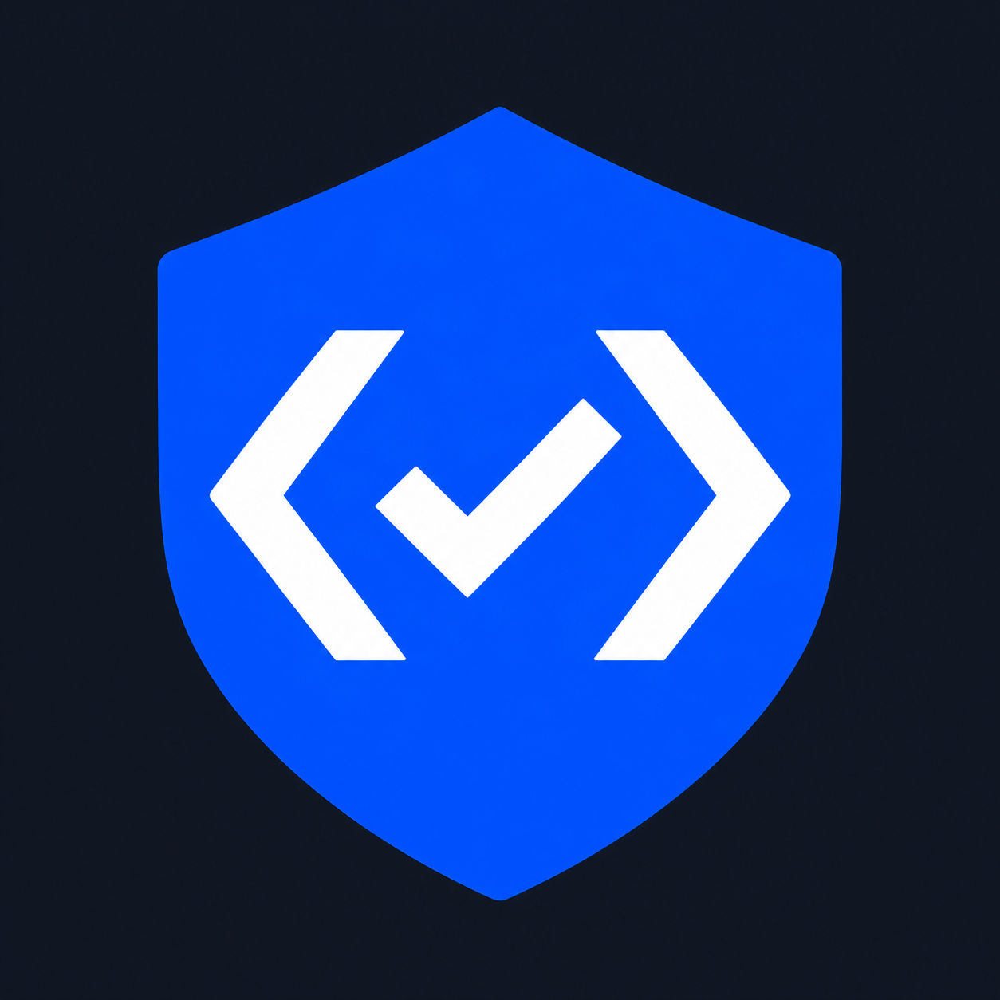

<div align="center">



<h1>EvidenceGuard</h1>


<p><strong>Find risky code. Inspect the evidence. Review the fix.</strong></p>

<p>A local source-code vulnerability scanner with clear findings, optional local AI explanations, and defensive fix guidance.<br>Built with Python, FastAPI, and Ollama for CSC 733.</p>

<p>
  <a href="https://github.com/Hussein-Sbeiti/EvidenceGuard/releases"></a>
  <a href="#download-and-run"></a>
  <a href="#run-from-source"></a>
  <a href="#local-ai"></a>
  <a href="TODO.md"></a>
</p>

<p>
  <a href="https://github.com/Hussein-Sbeiti/EvidenceGuard/releases"><strong>Download</strong></a>
  &nbsp;·&nbsp;
  <a href="#download-and-run">Getting started</a>
  &nbsp;·&nbsp;
  <a href="docs/SETUP.md">Source setup</a>
  &nbsp;·&nbsp;
  <a href="docs/AI_TRAINING_PLAN.md">Training roadmap</a>
  &nbsp;·&nbsp;
  <a href="TODO.md">Project status</a>
</p>

</div>

---

## Download and run

**Start here if you want to use the app.** Python and the scanner libraries are included in the desktop download.

1. Open [Releases](https://github.com/Hussein-Sbeiti/EvidenceGuard/releases) and expand **Assets** under the preview release.
2. Download the package for your computer:

   | Computer | Download | Open after extracting |
   | --- | --- | --- |
   | Linux x86-64 | `VulnAI-Scanner-linux-x86_64.tar.gz` | `VulnAI-Scanner` |
   | Mac with Apple Silicon (M series) | `VulnAI-Scanner-darwin-arm64.zip` | `VulnAI-Scanner.app` |
   | Mac with an Intel processor | `VulnAI-Scanner-darwin-x86_64.zip` | `VulnAI-Scanner.app` |

3. Extract the whole archive, then open the app. Keep the extracted Linux folder together.
4. Your browser opens the local setup page. First-time AI setup downloads the runtime and model; keep internet connected and allow several minutes and at least **10 GB free disk space**. You can open the scanner and use rule checks while AI setup runs.
5. Once setup finishes, the scanner opens automatically. Later launches reuse the installed files and can work offline. Use **App setup and quit** in the sidebar when you want to stop the local server.

Choose the named app package above; GitHub's **Source code** archives are for developer setup. Windows packaging is planned for a later round.

**Preview status:** the Mac apps are not Apple-notarized, so macOS may block opening them. The Linux download is a development-host preview; compatibility with older distributions still needs testing. See [desktop setup and limitations](docs/DESKTOP_DISTRIBUTION.md) for platform verification, storage locations, and release details.

---

## Scan your code

1. Choose **Scan source** in the sidebar.
2. Select files or a project folder.
3. Optionally enable **Explain findings with Ollama**. CVE and dependency lookups are separate, optional internet features.
4. Click **Scan selected files**.
5. Review each finding's file, line, CWE, explanation, and suggested mitigation. Export the result as JSON or a readable report when needed.

Try the [educational examples](examples/README.md) for a first scan. Findings and AI advice need review; suggested fixes are not applied automatically.

Upload limits are **50 files**, **512 KB per file**, and **5 MB total**. Use supported UTF-8 source files or dependency manifests; the UI explains skipped files.

### What it checks

- Risky SQL construction, dynamic code execution, unsafe deserialization, shell command construction, HTML insertion, and hard-coded credentials.
- Python syntax with AST analysis and JavaScript/TypeScript/JSX/TSX with Tree-sitter. Other supported languages have narrower credential-pattern checks.
- Exact dependency pins in `requirements.txt` and `package-lock.json`, with optional OSV advisory lookups.
- CVE identifiers through optional CVE.org/NVD queries and locally indexed Exploit-DB references.

A clean result is not proof that code is secure. Rule matches identify candidates for review; database references do not establish exploitability. See the [analysis details](docs/TECHNICAL_REFERENCE.md#how-it-works) and [evaluation notes](evaluation/README.md).

### What stays local

Source files are analyzed in memory and are not saved by the scanner. Optional AI receives short flagged excerpts through local Ollama. Online lookups send CVE IDs or package names/versions; they do not send uploaded source. Exported reports can contain excerpts, so review them before sharing.

---

## Run from source

For development, use Python **3.10+**. Run these commands on Linux/macOS:

```bash
git clone https://github.com/Hussein-Sbeiti/EvidenceGuard.git
cd EvidenceGuard
python3 -m venv .venv
source .venv/bin/activate
python -m pip install -r requirements.txt
python -m uvicorn app.main:app --host 127.0.0.1 --port 8000
```

Open **<http://127.0.0.1:8000>**. Stop the server with `Ctrl+C`.

Already have a checkout? Start from `cd` into that folder and reuse its environment. For Windows PowerShell, optional `.env` settings, and troubleshooting, follow the [platform setup guide](docs/SETUP.md).

## Local AI

Desktop previews handle first-time AI setup. For a source checkout, install [Ollama](https://ollama.com/download), then download the model:

```bash
ollama pull qwen2.5-coder:3b
```

Keep Ollama running. If it is not already serving, start it with `ollama serve`. In EvidenceGuard, click **Check local AI**, then enable **Explain findings with Ollama** for a scan.

The current model is **base Qwen 2.5 Coder 3B**. It explains existing rule findings; it does not independently detect new vulnerabilities, confirm exploitability, or apply repairs. The model name for source setup can be changed with `OLLAMA_MODEL`; see [AI configuration and boundaries](docs/TECHNICAL_REFERENCE.md#optional-local-ai-with-ollama).

## Training roadmap

Fine-tuning is in preparation. **No project-trained model has been released.** The first pilot covers SQL explanations and defensive fixes, followed by command injection, unsafe deserialization, eval/exec, XSS, and credential handling. Each topic needs vulnerable, safe, and insufficient-context examples.

The [training plan](docs/AI_TRAINING_PLAN.md) covers small LoRA experiments, reviewed data, and overfitting controls. The [pilot workflow](training/README.md) records current readiness and commands. Independent AI detection and validated patch generation remain later stages.

---

## Developer checks

```bash
python -m unittest discover -s tests -v
python -m app.evaluate --output-dir .cache/evaluation
```

Frontend checks require Node.js:

```bash
node tests/frontend/ui-utils.test.mjs
node tests/frontend/ai-ui.test.mjs
node --check app/static/app.js
```

The [65 synthetic evaluation cases](evaluation/README.md) still await independent label review. Fixture scores are not real-world accuracy estimates. Browser checks remain tracked separately in [BROWSER_QA.md](docs/BROWSER_QA.md).

## Documentation

| Guide | Use it for |
| --- | --- |
| [Source setup](docs/SETUP.md) | Linux, macOS, Windows, and optional environment settings |
| [Desktop distribution](docs/DESKTOP_DISTRIBUTION.md) | Native downloads, first-run setup, builds, and platform limitations |
| [Technical reference](docs/TECHNICAL_REFERENCE.md) | Analysis behavior, local AI boundaries, advisory providers, and research references |
| [Dependency scanning](docs/DEPENDENCY_SCANNING.md) | Supported manifests, OSV checks, and uncertainty handling |
| [Training plan](docs/AI_TRAINING_PLAN.md) | Scope, data, lightweight fine-tuning, and evaluation |
| [Training pilot](training/README.md) | Tokenizer preflight, review workflow, and the local AMD target |
| [Project backlog](TODO.md) | Completed work and next steps |
